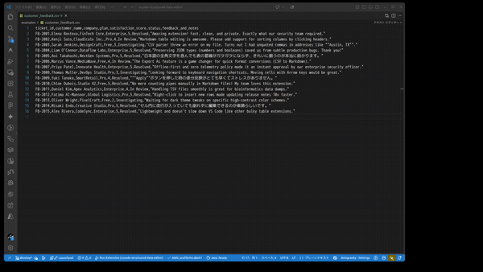
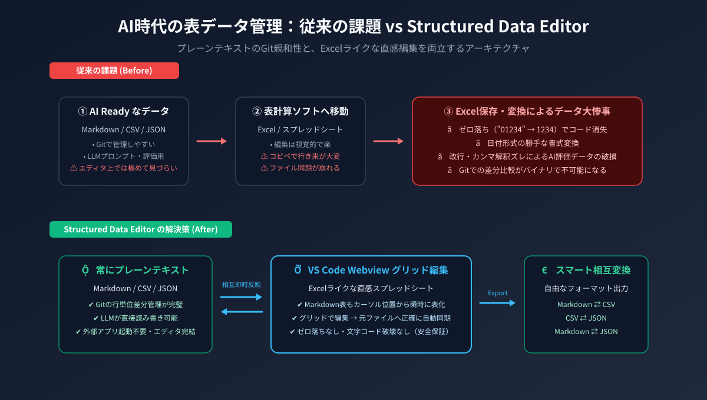
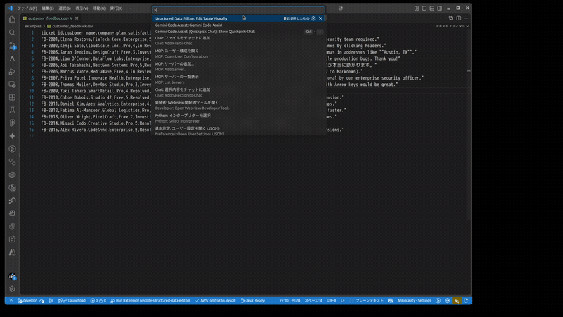
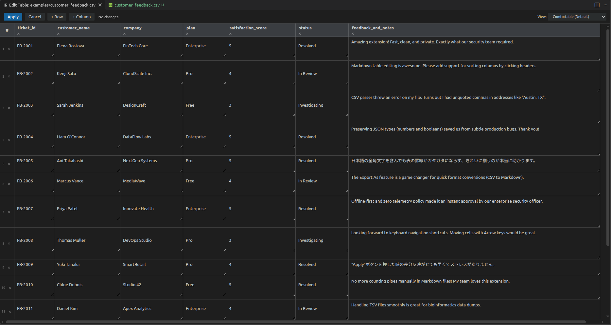

<div align="center">


# Structured Data Editor for VS Code

**Markdown 表、CSV、TSV、JSON を Excel ライクな直感スプレッドシートで視覚的に編集。**  
**完全オフライン＆Git 親和性を保ちながら、大切なデータを 100% プレーンテキストのまま安全に管理します。**

[](https://marketplace.visualstudio.com/items?itemName=ai-nexus-jp.vscode-structured-data-editor)
[](https://marketplace.visualstudio.com/items?itemName=ai-nexus-jp.vscode-structured-data-editor)
[](https://github.com/ai-nexus-jp/vscode-structured-data-editor/actions)
[](LICENSE)
[](https://ai-nexus.jp)

[English Documentation](README.md) • [日本語ドキュメント](README.ja.md)

<br />



</div>

---

## 💡 Structured Data Editor が解決する課題

AI アシスタント（LLM）やモダンな開発ワークフローでは、**Markdown 表**、**CSV データセット**、**JSON 配列** といった構造化テキストが頻繁に使われます。  
しかし、これらをエディタ上で直接手動編集するのは骨が折れ、かといって Excel 等の表計算ソフトで開いて保存すると、勝手な書式変換やゼロ落ちによってデータが大惨事になるリスクを抱えていました。

<div align="center">
  
</div>

| 従来の課題 (Before) | Structured Data Editor の解決策 (After) |
| :--- | :--- |
| ❌ **手動編集の苦痛**: パイプ記号（`\|`）の桁揃えやカンマの数え間違いでレイアウトが崩れる | ✅ **直感的なグリッド編集**: Excel やスプレッドシート感覚でセルをクリック・入力。行や列の追加・削除もワンクリック |
| ❌ **Excel保存によるデータ破壊**: 「ゼロ落ち」（`0123` → `123`）や日付の強制変換、意図しない文字コード化け | ✅ **100% プレーンテキスト保証**: 文字列や型、クォートを厳密に保持。勝手な自動キャストによるデータ破損ゼロ |
| ❌ **Git差分追跡の崩壊**: バイナリ形式（`.xlsx` 等）での保存は行単位のコードレビューや Git 差分比較が不能 | ✅ **Gitフレンドリー**: 変更は元のテキストファイルに直接、最小限の差分として書き戻されるため履歴管理が完璧 |
| ❌ **外部アプリとの行き来**: エディタと外部デスクトップソフトを行き来するコピペ作業が煩雑 | ✅ **エディタ完結**: VS Code 内で開いて編集し、ワンクリックで適用（Apply）。外部ソフト起動は一切不要 |

---

## ✨ 主な機能と特徴

### 1. Markdown テーブル: カーソル位置から瞬時に表化・インプレース編集
Markdown ドキュメント内の表の上にカーソルを置き、コマンドを実行するだけで専用グリッドが起動。  
編集後に **Apply** を押すと、そのテーブル部分だけが正確に更新され、周囲の見出し・段落・コードブロックには一切影響を与えません。

<div align="center">
  
  <p><em>ドキュメント全体の構造を崩すことなく、対象の表だけを安全に編集・整形</em></p>
</div>

- **アライメント（配置）対応**: 左寄せ・中央揃え・右寄せを視覚的に設定・維持。
- **全角・CJK文字の幅考慮**: 日本語などの全角文字が含まれていても、パイプ表の罫線幅を美しく自動整列。
- **安心の局所置換**: 前後のフロントマターやコメントも完全に保護されます。

---

### 2. CSV / TSV ファイル: フル機能スプレッドシート表示
`.csv` や `.tsv` ファイルを開くと、行・列の管理がしやすいクリーンな表形式で表示されます。

<div align="center">
  
  <p><em>列の追加・削除、並び替え、セルインライン編集に対応した洗練された UI</em></p>
</div>

- **区切り文字の自動判別**: カンマ（`,`）、タブ（`\t`）、セミコロン（`;`）、パイプ（`\|`）を賢く自動認識。
- **RFC 4180 準拠の堅牢なパース**: ダブルクォートで囲まれたセル、改行を含むセル、エスケープクォートも正確に処理。
- **データ整合性の保護**: 列数が不揃いな壊れた CSV 行を検出した場合、勝手に切り捨てず、「Go to Line X」ボタン付きで安全に通知します。

---

### 3. JSON（オブジェクト配列）: テーブル形式での直感編集
オブジェクトの配列で構成された JSON ファイルを、キーを列名とした分かりやすい表形式で展開。

- **型情報の保持**: 数値、真偽値（boolean）、`null` などの型を崩さず正確に保持して保存。
- **ネスト構造の扱い**: ネストされたオブジェクトや配列もコンパクトな JSON 文字列として確認・編集可能。

---

### 4. スマート相互変換（"Export As..."）
Markdown の表を CSV に変換したい、CSV データを JSON 配列に変換したいといったニーズにも即座に対応。

- **Markdown ⇄ CSV ⇄ JSON** の間で自由にエクスポート可能。
- **不可逆変換の事前警告**: 出力先フォーマットでアライメントや型が単純化される場合は、モーダルプレビュー上で事前に明示的な注意喚起を表示。
- **元ファイルを上書きしない非破壊設計**: 別名保存や安全な新規出力フローを採用。

---

## 🚀 使い方

1. VS Code で Markdown、CSV、TSV、または JSON ファイルを開きます。
2. Markdown の場合は、編集したい表の中にカーソルを置きます。
3. コマンドパレット（`Ctrl+Shift+P` / `Cmd+Shift+P`）を開き、以下を実行します：
   ```text
   Structured Data Editor: Edit Table Visually
   ```
4. グリッド上で自由にデータを編集：
   - セルをクリックまたはダブルクリックして値を直接編集。
   - ツールバーやボタンから行・列の追加や削除を実行。
   - **Apply** をクリックして元ファイルへ変更を反映。
   - **Cancel** をクリックすれば、編集内容は破棄され元ファイルは一切変更されません。
5. フォーマット変換を行いたい場合は、以下を実行します：
   ```text
   Structured Data Editor: Export As...
   ```

---

## 🛡️ プライバシーと安全性へのこだわり

- **100% ローカル実行（完全オフライン）**: パース、レンダリング、シリアライズの全処理はお使いのローカルマシン（VS Code 内）で実行されます。
- **テレメトリ・通信ゼロ**: ユーザーデータの外部送信、アクセス解析、外部 API 呼び出しは一切行いません。企業データや機密データセットも安心して編集いただけます。
- **厳格なサンドボックス**: Webview は厳格な Content Security Policy (CSP) で保護されています。

---

## ❓ トラブルシューティング & FAQ

### Q: 「Record X has Y fields but the header has Z」というエラーが出ます
**A:** この安全機構は、CSV のある行の列数がヘッダー行で定義された列数と一致しない（カンマが多すぎる、または少なすぎる）場合に発生します。

**よくある原因:**
1. **テキスト内にエスケープされていないカンマがある**: `Tokyo, Japan` や `1,500` のようなカンマを含むテキストは、二重引用符（`"Tokyo, Japan"`）で囲まれていないと、新しい列の区切りとして認識されてしまいます。
2. **クォートの閉じ忘れ**: 前の行などで引用符が閉じられていないと、複数行が誤って合体してパースされることがあります。

**対処法:**
- エラー通知内の **「Go to Line X」** ボタンをクリックすると、問題のある行に直接ジャンプできます。
- カンマを含むフィールドをダブルクォート（`"`）で囲むか、列数を修正してから再度コマンドを実行してください。

> **データ整合性への設計思想**: 多くのツールは列数の不一致を勝手に推測してデータを切り捨ててしまいます。Structured Data Editor はユーザーの貴重なデータを保護することを最優先とし、安易な自動修正を行わず安全に警告します。

---

## 🏢 作成者・ブランドについて (AI Nexus)

**Structured Data Editor** は **[AI Nexus](https://ai-nexus.jp)** によって開発・メンテナンスされています。

AI Nexus では、AI 時代のソフトウェア開発者やビジネスパーソンの生産性を最大化するためのモダンな開発ツール、業務変革ソリューションを提供しています。

- 🌐 **Web サイト**: [https://ai-nexus.jp](https://ai-nexus.jp)
- 🐙 **GitHub**: [@ai-nexus-jp](https://github.com/ai-nexus-jp)
- 🐛 **不具合報告・ご要望**: [GitHub Issues](https://github.com/ai-nexus-jp/vscode-structured-data-editor/issues)

本拡張機能がお役に立ちましたら、ぜひ **[Visual Studio Marketplace](https://marketplace.visualstudio.com/items?itemName=ai-nexus-jp.vscode-structured-data-editor) での ★★★★★ レビュー** や GitHub での Star をお願いいたします！

---

## 📄 ライセンス

MIT License に基づいて公開されています。詳細は [LICENSE](LICENSE) をご確認ください。

